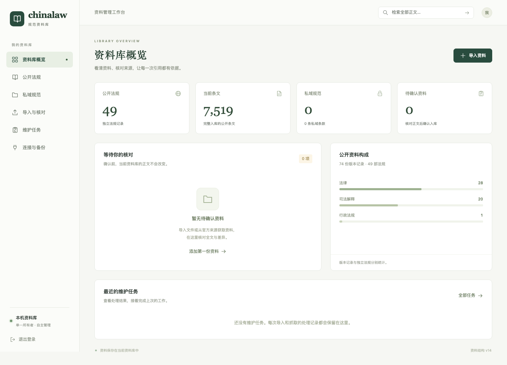

<h1 align="center">chinalaw</h1>

<p align="center"><strong>让每一条法律依据，回到原文</strong></p>

<p align="center">面向法律研究与 AI 工作流的中国法规资料库：核对条文、辨明版本、保留来源。</p>

<p align="center">
  <a href="https://github.com/nh59yytyd5-dev/chinalaw-cli/actions/workflows/test.yml"></a>
  <a href="https://github.com/nh59yytyd5-dev/chinalaw-cli/releases"></a>
  
  <a href="LICENSE"></a>
</p>

<p align="center"><strong>简体中文</strong> · <a href="README.en.md">English</a></p>

<p align="center">
  <a href="#开始使用">开始使用</a> ·
  <a href="#接入-ai-客户端">接入 AI 客户端</a> ·
  <a href="#自托管与管理面板">自托管</a> ·
  <a href="#数据与来源">数据与来源</a> ·
  <a href="#文档">文档</a>
</p>

`chinalaw` 把公开的法律、行政法规和司法解释整理成按条可查的资料库。每一条返回的条文都带效力状态、施行日期、版本、官方来源与核查时间：模型可以提出线索，引用却要回到工具取出的原文，人和 agent 都能复核。它不回答法律问题，也不替代法律判断。

```console
$ chinalaw article 民法典 533 --format md
## 民法典 第五百三十三条

> 合同成立后，合同的基础条件发生了当事人在订立合同时无法预见的、不属于商业风险的重大变化，继续履行合同对于当事人一方明显不公平的，受不利影响的当事人可以与对方重新协商；在合理期限内协商不成的，当事人可以请求人民法院或者仲裁机构变更或者解除合同。
人民法院或者仲裁机构应当结合案件的实际情况，根据公平原则变更或者解除合同。

---
- 文本状态：current
- 施行日期：2021-01-01
- 当前版本：2020-05-28 发布 / 2021-01-01 施行
- 来源：https://flk.npc.gov.cn/detail?id=ff808081729d1efe01729d50b5c500bf
- 最后核查：核查 181 天前
```

同一套资料有四种用法，可以组合：

| 用法 | 适合 | 资料在哪里 |
| --- | --- | --- |
| [公开法规快照](https://law.newcombmath.com/about/data.html) | 研究、批量处理、离线使用 | JSON / SQLite 下载到自己的机器 |
| CLI 与本地 MCP | Claude Code、Codex、Cursor 等 agent，个人研究 | 本机 SQLite；合同、案件材料不出本机 |
| [托管 MCP](https://law.newcombmath.com/about/mcp.html) | 少量在线查询、体验 | law.newcombmath.com，按需申请只读令牌 |
| 自托管服务 | 团队、多客户端 | 自己的服务器：浏览器管理面板与只读 REST / MCP HTTP |

## 一次可复核的引用

1. **定位**：知道法规和条号，直接取原文（`article`）；法规名不确定，先解析全称和候选（`resolve`，支持俗称、简称和文号）。
2. **核验**：条号相同，版本可能不同。核对正文是否对题，以及效力状态、施行日期和来源；事实发生在过去时，按当时的版本查（`--as-of`），时间效力线索见 `applicable`（只给线索，不下结论）。
3. **补齐**：没有线索或需要配套规定时再检索（`search`），最终引用回到完整条文，而不是搜索摘要。本地没有的法规或条文会明确报错（`law_missing`、`article_null`、`needs_fetch`），不会让 agent 误以为引用成功；可按诊断从官方来源补抓（`ensure` / `fetch`）。

## 开始使用

需要 Python 3.10 或更高版本。

### 安装

从[最新 release](https://github.com/nh59yytyd5-dev/chinalaw-cli/releases/latest) 下载 wheel：

```bash
python -m pip install ./chinalaw-0.7.4-py3-none-any.whl              # CLI 与本地 MCP，无第三方依赖
python -m pip install './chinalaw-0.7.4-py3-none-any.whl[server]'    # 另含管理面板与 HTTP 服务
```

给 Claude Code、Codex 等本机 agent 使用时，也可以从仓库安装：

```bash
git clone https://github.com/nh59yytyd5-dev/chinalaw-cli.git
cd chinalaw-cli
scripts/setup-agent                 # Windows PowerShell：.\scripts\setup-agent.ps1
```

`setup-agent` 会创建仓库内的 `.venv`，把 `chinalaw` 和 `chinalaw-mcp` 写到 `~/.local/bin`（Windows 为 `%USERPROFILE%\.local\bin`），首次运行时载入随包基线并做健康检查；命令找不到时把该目录加入 `PATH`。更新：`git pull` 后运行 `scripts/update-local`（Windows：`.\scripts\update-local.ps1`）。

### 准备数据

**公开法规快照**（推荐）：2486 条法规记录、87962 条条文记录、2499 份版本，数据截止 2026-09-30，挂在 [v0.7.1 发布页](https://github.com/nh59yytyd5-dev/chinalaw-cli/releases/tag/v0.7.1)。SQLite 包解压即可查询：

```bash
tar -xzf chinalaw-public-2026-09-30-sqlite.tar.gz
chinalaw --db ./chinalaw-public-2026-09-30-sqlite/library.db article 民法典 533
```

SQLite 包需要 chinalaw 0.7.1+ 与支持 FTS5 / trigram 的 SQLite 3.34+；遇到兼容问题时改用 JSON 包导入新库（`chinalaw --db ./public-library.db sync --from-dir <解压目录>/laws`）。记录数含历史版本，不等于全部中国规范，也不是实时更新；此后的软件版本没有重新打包数据。范围与质量边界见[公开数据页](https://law.newcombmath.com/about/data.html#limits)。

**随包基线**：`chinalaw init` 载入内置 74 份公开规范文本（入库为 49 部法规）与时间效力规则，不需要联网，适合离线起步和测试，但只覆盖常用法典、程序法和主要司法解释。

快照另建一库，用 `--db` 指向它（CLI 也读取环境变量 `CHINALAW_DB`），不要覆盖自己的工作库。`status` / `doctor` 报告的是当前这一库的规模。

### 查询

```bash
chinalaw resolve 民法典 --format json             # 俗称 / 简称 / 文号解析到正式记录
chinalaw article 民法典 第一百四十三条 --format md
chinalaw articles 民法典 --numbers "143,464,509,577" --format json
chinalaw search 合同效力 --kind article --limit 5 --format md
chinalaw outline 民法典 --limit 20 --format md
chinalaw ensure 劳动合同法 --format json           # 本地已有则跳过，缺失才抓取
chinalaw doctor --format md                      # 安装、数据库、MCP 与 skills 健康检查
```

默认输出 JSON，多数命令支持 `--format md`。`fetch` / `ensure` 访问公开官方来源，可能受上游改版、网络和限流影响，脚本里应检查返回的 `ok`、`error` 和 `source_*` 字段。完整命令与字段说明见 [docs/CONTRACT.md](docs/CONTRACT.md)，更多示例见 [docs/EXAMPLES.md](docs/EXAMPLES.md)。

## 接入 AI 客户端

### 本地 stdio MCP（推荐）

`chinalaw-mcp` 随 CLI 安装，只查本机 SQLite，无需令牌。在支持 `mcpServers` 的客户端中这样配置，路径换成你机器上的绝对路径：

```json
{
  "mcpServers": {
    "chinalaw": {
      "command": "/absolute/path/to/chinalaw-mcp",
      "args": ["--db", "/absolute/path/to/library.db"]
    }
  }
}
```

工具为 `chinalaw_resolve`、`chinalaw_search`、`chinalaw_article`、`chinalaw_articles`、`chinalaw_applicable`、`chinalaw_ensure`。私域规范默认不经 MCP 暴露，确需时加 `--allow-private-norms` 启动。

### 托管 HTTP MCP

- 地址 `https://law.newcombmath.com/mcp`（Streamable HTTP），请求头 `Authorization: Bearer <你的令牌>`，权限只有公开库只读（`chinalaw:public:read`）。
- 不提供共享令牌，也不开放匿名检索。需要时在 GitHub [提交申请](https://github.com/nh59yytyd5-dev/chinalaw-cli/issues/new?title=MCP%20hosted%20access%20request)，说明用途与预计频率；不要在 Issue 里贴令牌。
- 这是小规模共享服务，有速率与并发限制，不承诺可用性。查询会记录工具、参数与命中概况，不记录返回正文；请不要提交可识别的案件信息。批量研究与生产集成请下载数据或自托管。
- 工具为 `chinalaw_resolve`、`chinalaw_article`、`chinalaw_search`、`chinalaw_list`、`chinalaw_document`、`chinalaw_applicable`。客户端配置、凭据文件与连接检查（`chinalaw-remote-check`）见 [MCP 客户端接入](docs/MCP_CLIENT.md) 与[在线接入文档](https://law.newcombmath.com/about/mcp.html)。

### CLI 与 skills

能调 shell 的 agent 可以直接用 CLI。把下面这段放进 Claude Code、Codex、Cursor 或 OpenCode 的全局规则：

```text
涉及中国法、法条、司法解释、合同审查、劳动/公司/民商事/刑事问题时，
先用本机 chinalaw CLI 取得原文，不要凭模型记忆引用。
- 已知法规和条号：chinalaw article <law> <number> --format json
- 多条：chinalaw articles <law> --numbers <nums> --format json
- 法规名不确定：chinalaw resolve <name> --format json
- 没有线索或需要配套规定：chinalaw search <query> --kind article --limit 10 --format json
- 事实发生在过去：article 加 --as-of YYYY-MM-DD
- 本地缺失：chinalaw ensure <law> --format json
核对返回的正文是否对题，以及效力状态和施行日期。
如果返回 law_missing、law_stub、law_seed、article_null 或 needs_fetch，
按诊断信息补全，或明确告知本地数据不足。
```

仓库自带 7 份 skill（检索方法、引用核对、合同审查、法律研究等），默认只作为文档随仓库分发；需要全局加载时执行 `scripts/install-skills --copy`（Windows：`.\scripts\install-skills.ps1`），`--uninstall` 可移除。调用顺序、输出纪律、语料安装和 grounding 快照审计见 [docs/AGENT_WORKFLOWS.md](docs/AGENT_WORKFLOWS.md)。

## 自托管与管理面板

`chinalaw-server` 是可选组件：在浏览器里看清库里有什么、逐条核对入库文本、审阅差异后再确认写入；同时提供只读 REST 与 MCP HTTP，供多台设备上的 agent 查询同一套资料库。托管的 law.newcombmath.com 运行的就是它。

<p align="center"></p>

```bash
python -m pip install './chinalaw-0.7.4-py3-none-any.whl[server]'
# 仓库内安装：scripts/install-local --with-server（Windows：.\scripts\install-local.ps1 -WithServer）
chinalaw-server init --with-fixtures    # 随包基线；全国公开法规按在线接入文档导入快照
chinalaw-server serve --open            # 终端输出一次性配对链接，进入面板后可设置密码
```

- 上传文件或从官方来源抓取都先生成预览：完整正文、原件、增删改差异，人工核对后才入库，核对记录绑定具体内容版本。
- 单所有者登录，可签发和撤销只读令牌；MCP 客户端走 OAuth / PKCE。
- 备份包含来源附件，可校验、预览冲突后事务性恢复，用于在本机与服务器之间迁移。
- 自托管使用仓库内的 `Dockerfile` 与 `deploy/compose.yaml`（Caddy 反向代理与 HTTPS）。

运行面板不需要 Node.js 或任何模型 API。以上是本机模式；部署到公网需要 HTTPS、所有者密码、反向代理与独立令牌，不要把本机配对模式直接暴露到公网。导入快照的做法见[在线接入文档](https://law.newcombmath.com/about/mcp.html#selfhost)，操作、部署和客户端接入见 [docs/ADMIN_SERVER.md](docs/ADMIN_SERVER.md)。

## 私域规范

公司制度、甲方放款要求、内部合规手册、行业标准可以和公开法规一起检索，但只存本机、不随包分发，输出层始终标明**它们不是国家法规范**：检索命中带 `hierarchy: "private_norm"` 与约束力提示 `binding_note`，与公开法同时命中时附 `conflict_notice`。

```bash
chinalaw norm import data/norms/acme-lending-policy.json --format json   # 随仓库的虚构示例
chinalaw norm ingest path/to/policy.md --name "内部合规手册" --source-type internal_governance
chinalaw search 担保审批 --kind norm --format md
```

`ingest` 支持 txt / md / docx / pdf，按“第 N 条”切分并识别章节层级；`norm history` / `norm diff` / `norm delete` 管理生命周期，`norm export` 附防泄漏标注。`--source-type` 的受控取值见 [docs/CONTRACT.md](docs/CONTRACT.md) §2.9。

## 数据与来源

- **公开法规快照**从审查后的公开 JSON 独立构建，以全国层级公开法规为主，含历史版本；不是线上数据库备份，不含认证、日志、私域规范或案件材料。托管实例兼容旧 ID，记录数略多于下载包。核对范围见[入库质量报告](docs/research/2026-09-29-national-import-quality.md)与包内 `QUALITY.md`。
- **随包基线**为内置 74 份完整公开规范文本：宪法与刑法的历次文本、民法典、民事 / 刑事 / 行政诉讼法、公司法、劳动合同法、个人信息保护法等，以及民法典配套解释和主要的诉讼、合同、劳动司法解释。入库后为 49 部法规、7519 条条文、74 份版本（宪法、刑法的历次文本是同一部法规的版本）。完整清单见 [docs/DATA_INDEX.md](docs/DATA_INDEX.md)。基线保证离线可用，快照提供规模，二者互不替代。
- **官方来源**：已实现 12 个官方来源适配器：国家法律法规数据库（`flk_npc`）、国家行政法规库（`gov_xzfgk`）、最高人民法院公报与主站（`court_gongbao`、`court_main`）、最高人民检察院（`spp_gov_cn`）、证监会（`csrc_gov_cn`）、国家金融监督管理总局（`nfra_gov_cn`），以及沪深北交易所、中国结算和证券业协会的规则。抓取遵守 [docs/COMPLIANCE.md](docs/COMPLIANCE.md)：低频、只取公开文本、保留来源与哈希。
- 感谢原文备份仓库 [lawtext/legal-data-docx](https://github.com/lawtext/legal-data-docx)。官方出处、核查时间和来源哈希保留在数据包中，详见[数据来源与权利说明](data/public-release/NOTICE.md)。

```bash
chinalaw sources list --implemented-only --format md
chinalaw sources show flk_npc --format json      # 每个来源支持的命令边界
```

## 命令速查

| 命令 | 用途 |
| --- | --- |
| `init` | 加载随包公开规范基线与时间效力规则，并运行健康检查 |
| `resolve <name>` | 俗称 / 简称 / 文号解析到正式记录 |
| `article <law> <number>` / `articles <law> --numbers ...` | 单条 / 批量取条，`--as-of` 取当时有效的版本 |
| `search <query>` | 全文 / 条文检索，`--kind` 限定范围，同样支持 `--as-of` |
| `outline <law>` | 章节目录与正文预览 |
| `ensure <law>` / `fetch <law>` | 本地优先补全 / 从来源抓取入库 |
| `history` / `diff` / `applicable` / `relation` | 版本历史与时间效力线索 |
| `law delete <id>` | 按精确 id 删除单行公开法规（先 `--dry-run`） |
| `norm ...` / `pack ...` | 私域规范 / 规范包管理 |
| `audit <target>` / `cite-check <file>` | 审查文件中的法条引用是否可解析、文本是否一致 |
| `doctor` / `status` | 本机健康检查与数据新鲜度 |
| `chinalaw-mcp` / `chinalaw-server` | stdio MCP / 管理面板与 HTTP 服务 |

## 文档

- [docs/MCP_CLIENT.md](docs/MCP_CLIENT.md)：MCP 客户端接入、凭据文件与连接检查。
- [docs/ADMIN_SERVER.md](docs/ADMIN_SERVER.md)：管理面板与服务器的使用、部署和客户端接入。
- [docs/AGENT_WORKFLOWS.md](docs/AGENT_WORKFLOWS.md)：agent 调用顺序、输出纪律、语料安装与 skills。
- [docs/CONTRACT.md](docs/CONTRACT.md)：CLI / JSON / 退出码契约与数据模型；命令、字段和退出码按它演进。
- [docs/EXAMPLES.md](docs/EXAMPLES.md)：可执行的调用示例。
- [docs/DATA_INDEX.md](docs/DATA_INDEX.md)、[docs/COMPLIANCE.md](docs/COMPLIANCE.md)：内置数据与来源抓取边界。
- [docs/ARCHITECTURE.md](docs/ARCHITECTURE.md)、[docs/CLEANING.md](docs/CLEANING.md)：代码结构与清洗规则。
- [docs/PROJECT_CHARTER.md](docs/PROJECT_CHARTER.md)：项目定位与不做的范围。
- [CHANGELOG.md](CHANGELOG.md)、[SECURITY.md](SECURITY.md)、[NOTICES.md](NOTICES.md)。

## 参与开发

```bash
python3 -m venv .venv && . .venv/bin/activate
python -m pip install -e ".[dev,server]"
ruff check src tests tests_server
python -m pytest tests tests_server -q
scripts/check-public-fixtures
```

不安装也可以在仓库内直接运行 `PYTHONPATH=src python3 -m chinalaw ...`。面板前端在 `web/`（Node 22）：`npm ci && npm run build` 构建，`npm test` 跑浏览器验收（需先 `npx playwright install chromium`）；构建产物写入 `src/chinalaw/server/static/`，随源码一起提交。贡献流程见 [docs/CONTRIBUTING.md](docs/CONTRIBUTING.md)，模块边界与测试要求见 [docs/DEVELOPMENT_GUIDE.md](docs/DEVELOPMENT_GUIDE.md)。三条底线：法条缺失必须 fail loud；修复应是一类问题的通用规则，不为单部法规打补丁；新增外部来源先说明来源、节流、清洗、追溯与失败模式。

问题与建议请开 [GitHub Issues](https://github.com/nh59yytyd5-dev/chinalaw-cli/issues)，安全漏洞请按 [SECURITY.md](SECURITY.md) 私下报告。友链：[Linux.do](https://linux.do/)。

## 许可与免责声明

代码采用 [Apache License 2.0](LICENSE)，第三方依赖与数据来源登记见 [NOTICES.md](NOTICES.md)。法律、法规及国家机关的决议、决定、命令等依《著作权法》第五条不适用著作权法保护；第三方网站、释义材料、商业数据库和用户私域材料仍须遵守各自的权利与使用限制。

本项目只提供规范文本的检索、整理和引用便利，不构成法律意见。实际案件和交易应由执业律师或法务判断，并以官方发布渠道的最新文本为准。
